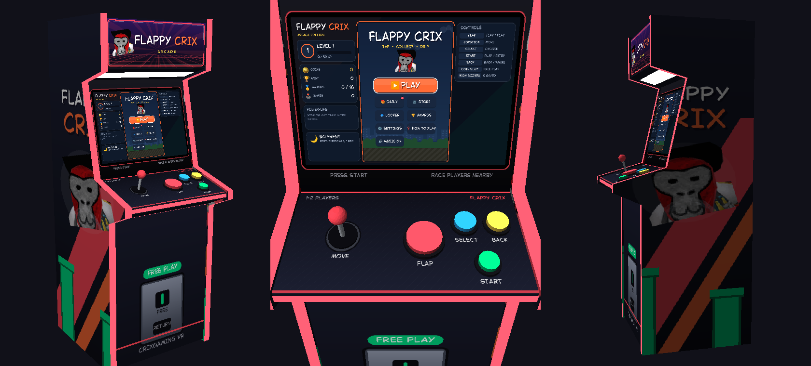
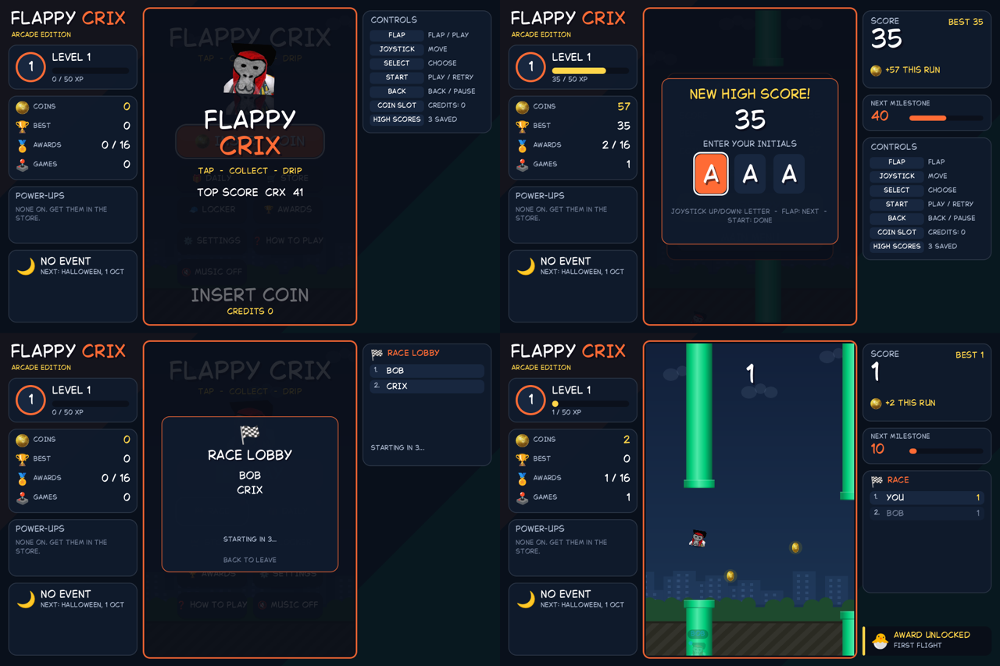

# Flappy Crix Arcade — Unity SDK

Flappy Crix as an arcade machine for **your own** VR game or Gorilla Tag fan game (this is not the
Gorilla Tag mod). Single-player arcade cabinet, or linked cabinets where players nearby race each
other through the room your game already uses — no extra Photon CCU.




Install with Package Manager → *Add package from git URL*:

```
https://github.com/CRIX447/FLAPPY-CRIX-GT.git?path=/unity-sdk/com.crixgamingvr.flappycrix-arcade
```

Then **GameObject → CRIX → Flappy Crix Arcade Machine**. Full guide:
[com.crixgamingvr.flappycrix-arcade/README.md](com.crixgamingvr.flappycrix-arcade/README.md).
